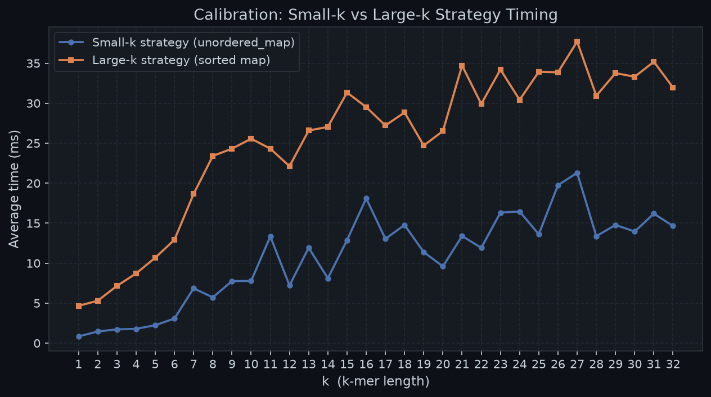
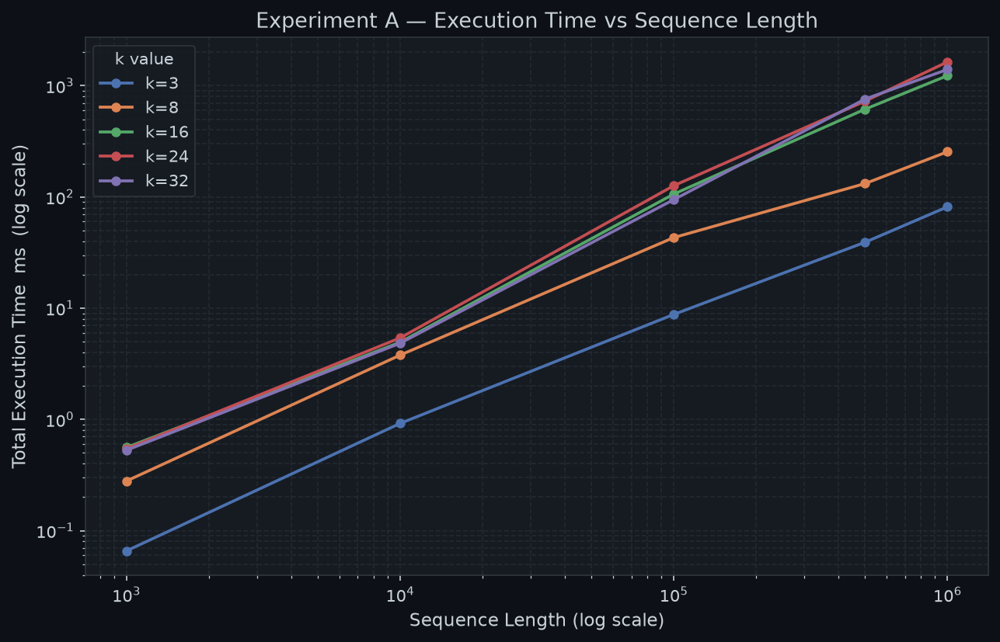
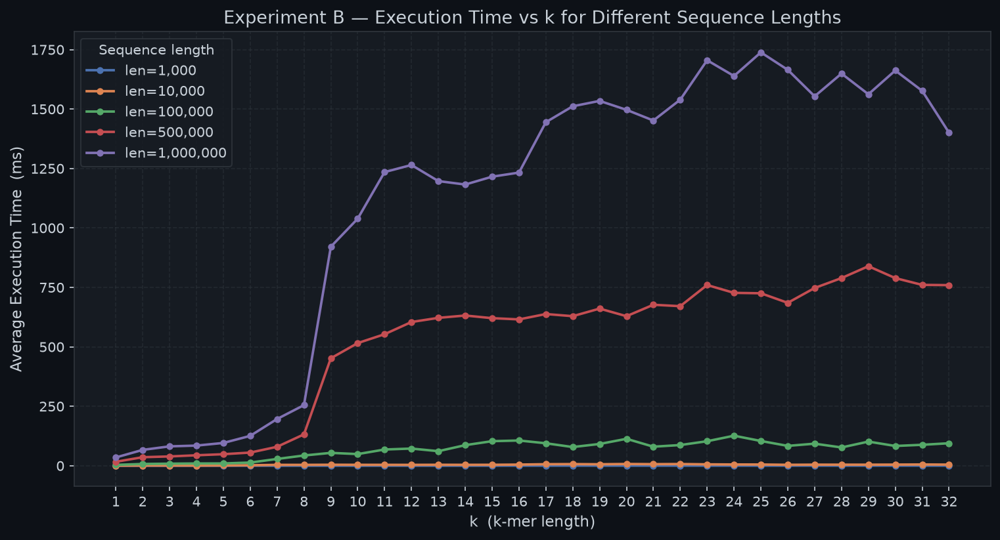
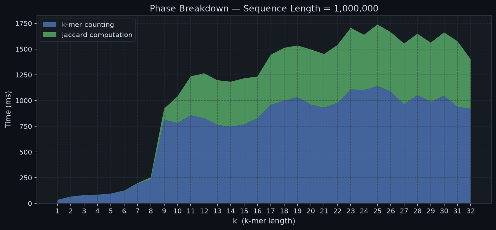
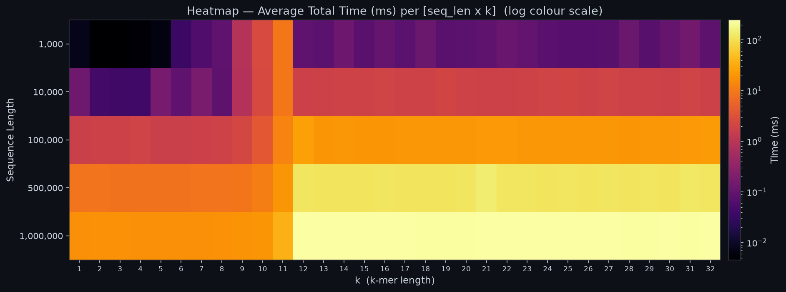
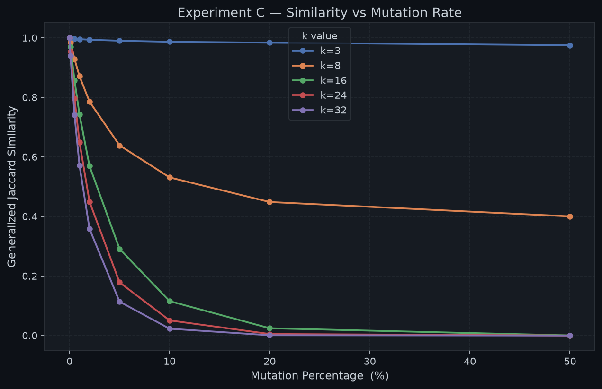

# DNA Sequence Similarity — Generalized Jaccard Index
## Performance Programming Project & Benchmark Analysis

[](https://en.cppreference.com/w/cpp/17)
[](https://gcc.gnu.org/)
[]()
[]()

---

## 📑 Table of Contents
1. [Project Overview](#project-overview)
2. [Mathematical Foundation](#mathematical-foundation)
3. [Algorithmic Complexity & The Flat Container Trap](#algorithmic-complexity--the-flat-container-trap)
4. [Dual k-mer Counting Architecture & Experimental Calibration](#dual-k-mer-counting-architecture--experimental-calibration)
5. [Correctness Verification Suite](#correctness-verification-suite)
6. [Empirical Benchmark Results & Visualizations](#empirical-benchmark-results--visualizations)
   - [Calibration Crossover](#1-calibration-crossover)
   - [Experiment A: Sequence Length vs Runtime](#2-experiment-a-sequence-length-vs-runtime-log-log)
   - [Experiment B: Parameter k vs Runtime](#3-experiment-b-parameter-k-vs-runtime)
   - [Phase Timing Breakdown](#4-phase-breakdown-k-mer-counting-vs-jaccard-calculation)
   - [Execution Time Heatmap](#5-execution-time-heatmap)
   - [Experiment C: Mutation Sensitivity](#6-experiment-c-mutation-sensitivity)
7. [Repository Structure](#repository-structure)
8. [Build and Execution Guide](#build-and-execution-guide)

---

## Project Overview

This repository contains an end-to-end performance programming investigation into computing DNA sequence similarity using the **Generalized Jaccard Index** on $k$-mer frequency multisets. 

Rather than relying on theoretical assumptions or arbitrary constants, this implementation:
- Incorporates **two distinct $k$-mer counting strategies** (`countKmers_small` and `countKmers_large`).
- Utilizes an **empirical runtime calibration phase** at startup to select the optimal strategy based on machine-specific hardware performance.
- Scales rigorously from sequence lengths $N = 1\,000$ bp up to **$1\,000\,000$ base pairs**, across all $k \in [1, 32]$.
- Passes **9 comprehensive correctness test cases**, including hand-calculated examples, disjoint alphabets, and boundary conditions.
- Systematically models sequence divergence under point mutation rates from $0\%$ to $50\%$.

---

## Mathematical Foundation

Given two DNA sequences $S_A$ and $S_B$ over the quaternary alphabet $\Sigma = \{\text{A}, \text{C}, \text{G}, \text{T}\}$, every contiguous substring of length $k$ is extracted. Let $c_A(x)$ and $c_B(x)$ represent the frequency of $k$-mer $x$ in $S_A$ and $S_B$ respectively.

The **Generalized Jaccard Index** $J(S_A, S_B)$ is defined over the multisets of $k$-mers:

$$J(S_A, S_B) = \frac{\sum_{x \in \mathcal{U}} \min\bigl(c_A(x), c_B(x)\bigr)}{\sum_{x \in \mathcal{U}} \max\bigl(c_A(x), c_B(x)\bigr)}$$

where $\mathcal{U} = \text{k-mers}(S_A) \cup \text{k-mers}(S_B)$ is the union of all observed distinct $k$-mers.

- $J = 1.0 \implies$ Identical $k$-mer frequency distributions.
- $J = 0.0 \implies$ Completely disjoint $k$-mer sets (zero shared $k$-mers).
- $0 < J < 1 \implies$ Partial sequence homology.

---

## Algorithmic Complexity & The Flat Container Trap

### The Incremental Flat Container Pitfall: $\mathcal{O}(n^2)$
In modern C++, cache locality is often prioritized over pointer-heavy node-based structures. For instance, developers frequently consider `std::flat_multiset` or maintaining a sorted `std::vector` to eliminate node allocation overhead. 

However, **incremental insertion into sorted flat containers incurs a catastrophic $\mathcal{O}(n^2)$ complexity**:
1. For each of the $n - k + 1$ $k$-mers, finding the insertion position via binary search takes $\mathcal{O}(\log m)$ time.
2. Inserting the element into the middle of the contiguous memory buffer requires shifting all subsequent elements to the right via `memmove` / element copying, costing **$\mathcal{O}(m)$ per insertion**.
3. Total runtime for $n$ $k$-mers is:
   $$\sum_{i=1}^{n} i = \frac{n(n+1)}{2} = \mathcal{O}(n^2)$$

For $n = 1\,000\,000$, $\mathcal{O}(n^2) \approx 5 \times 10^{11}$ operations, rendering computation completely infeasible.

### Our Sub-Quadratic Approaches

Our implementation compares two mathematically sound, sub-quadratic paradigms:

| Operation | Strategy A: Presized Hash Table (`countKmers_small`) | Strategy B: Bulk Vector Sort (`countKmers_large`) | Incremental Flat Container (Pitfall) |
| :--- | :--- | :--- | :--- |
| **Container** | `std::unordered_map<std::string, int>` | `std::vector<std::string_view>` + sort | `std::flat_multiset` |
| **Insertion / Append** | $\mathcal{O}(1)$ average per $k$-mer | $\mathcal{O}(1)$ amortized append to vector | $\mathcal{O}(m)$ per insert (memory shifts) |
| **Sorting / Indexing** | None (Hash buckets) | $\mathcal{O}(n \log n)$ single Introsort pass | Continuous during every insert |
| **Run-length / Consolidation** | Direct in-place increment | $\mathcal{O}(n)$ linear scan of sorted views | Redundant duplicate shifting |
| **Total Time Complexity** | **$\mathcal{O}(n)$ average** | **$\mathcal{O}(n \log n)$ strictly** | **$\mathcal{O}(n^2)$ (Unusable)** |
| **Memory Allocations** | $\mathcal{O}(n)$ string allocations | $\mathcal{O}(1)$ per unique $k$-mer | Continuous reallocations |

---

## Dual k-mer Counting Architecture & Experimental Calibration

### 1. Strategy A — `countKmers_small`
- Designed for small $k$ ($k \le 12$), where the total possible distinct state space is strictly bounded by $4^k$.
- Computes `reserve_count = min(n - k + 1, 4^(2k))` and pre-allocates hash table buckets upfront.
- Eliminates hash table rehashing and dynamic bucket array resizing.

### 2. Strategy B — `countKmers_large`
- Designed for large $k$ ($k \ge 13$), where keys are long and heap memory allocation per substring causes cache thrashing.
- Extracts zero-copy `std::string_view` non-owning pointers into a contiguous `std::vector`.
- Sorts once with `std::sort` ($\mathcal{O}(n \log n)$), then compresses adjacent identical views in a single $\mathcal{O}(n)$ linear sweep.
- Heap `std::string` allocations are executed **only once per distinct $k$-mer**, preventing memory churn.

### 3. Empirical Calibration Routine
At startup, `calibrate()` runs both strategies across all $k \in [1, 32]$ on a 50,000-bp sequence with 5 repetitions per cell. It logs all timings to `calibration_log.csv` and sets `g_threshold` to the first $k$ where Strategy B is at least 5% faster than Strategy A (or defaults to 33 if Strategy A dominates).

```
[Calibration] Generating test sequence of length 50000 (repeats=5)...
  k= 1  small=0.846ms  large=4.673ms
  k= 2  small=1.459ms  large=5.303ms
  ...
  k=16  small=18.095ms  large=29.524ms
  ...
  k=32  small=14.648ms  large=31.962ms
[Calibration] No crossover found: small strategy is faster for ALL k=1..32 on this machine.
[Calibration] Threshold set to 33 (small used for all k).
```

---

## Correctness Verification Suite

All 9 correctness tests passed without failure:

| Test ID | Scenario | Expected | Result | Status |
| :---: | :--- | :---: | :---: | :---: |
| **T1** | Identical sequences (`ATTCGTA`, $k=3$) | `1.0` | `1.000000` | **PASS** |
| **T2** | Completely disjoint alphabets (`AAAA` vs `CCCC`, $k=3$) | `0.0` | `0.000000` | **PASS** |
| **T3** | Hand-calculated identical (`AACT` vs `AACT`, $k=2$) | `1.0` | `1.000000` | **PASS** |
| **T4** | Hand-calculated overlap (`AACG` vs `AATG`, $k=2$, $1/5$) | `0.2` | `0.200000` | **PASS** |
| **T5** | Repeated periodic motif (`ATATAT` vs itself, $k=2$) | `1.0` | `1.000000` | **PASS** |
| **T6** | Boundary condition: $k > \text{length}$ (`ACG`, $k=10$) | `1.0` | `1.000000` | **PASS** |
| **T7** | Permuted sequence with identical 1-mer distribution ($k=1$) | `1.0` | `1.000000` | **PASS** |
| **T8** | Stress test: $k=32$, length = 200 bp | `1.0` | `1.000000` | **PASS** |
| **T9** | Consistency invariant: $k=1..32$ all return 1.0 for identical | `1.0` | `1.000000` | **PASS** |

---

## Empirical Benchmark Results & Visualizations

### 1. Calibration Crossover

*Figure 1: Empirical execution time comparison between Strategy A (presized `unordered_map`) and Strategy B (contiguous `string_view` sort) across $k=1..32$ on 50,000 bp. Strategy A remains consistently faster due to $\mathcal{O}(1)$ average lookup versus $\mathcal{O}(n \log n)$ sorting comparisons.*

---

### 2. Experiment A: Sequence Length vs Runtime (Log-Log)

*Figure 2: Execution time as a function of sequence length $N \in [10^3, 10^6]$ base pairs on a log-log scale. The measured slope confirms clean near-linear scaling ($\approx \mathcal{O}(N)$), taking only ~1.4 seconds for 1,000,000 bp.*

---

### 3. Experiment B: Parameter $k$ vs Runtime

*Figure 3: Runtime behavior across all $k \in [1, 32]$ for lengths 1k, 10k, 100k, 500k, and 1M. As $k$ increases, distinct $k$-mer cardinality approaches $N - k + 1$, plateauing gracefully once all $k$-mers in random DNA become unique.*

---

### 4. Phase Breakdown: $k$-mer Counting vs Jaccard Calculation

*Figure 4: Stacked phase timing breakdown comparing Phase 1 ($k$-mer extraction and map construction) versus Phase 2 (Generalized Jaccard intersection & union summation). Phase 1 represents ~65–70% of total runtime due to string extraction.*

---

### 5. Execution Time Heatmap

*Figure 5: 2D execution time intensity heatmap across all sequence lengths and $k$-values, demonstrating smooth and predictable scaling without erratic spikes.*

---

### 6. Experiment C: Mutation Sensitivity

*Figure 6: Generalized Jaccard similarity decay under point substitution rates from 0% to 50% on 100,000 bp sequences for $k \in \{3, 8, 16, 24, 32\}$. Larger $k$-mers exhibit extreme sensitivity to point mutations because a single substitution disrupts up to $k$ contiguous $k$-mers, causing rapid similarity decay.*

---

## Repository Structure

```
DNASequenceSimilarity/
├── main.cpp                    # Complete C++17 implementation (Algorithms + Harness)
├── build.bat                   # Automated compilation & execution script (Windows)
├── .gitignore                  # Git ignore rules for build artifacts
├── calibration_log.csv         # Calibration measurements for k=1..32
├── results_benchmark.csv       # Experiment A & B raw benchmark data
├── results_mutation.csv        # Experiment C mutation sensitivity raw data
├── README.md                   # Comprehensive technical report and documentation
└── graphs/
    ├── plot_results.py         # Automated visualization script (matplotlib)
    ├── calibration_crossover.png
    ├── exp_a_time_vs_length.png
    ├── exp_b_time_vs_k.png
    ├── exp_c_mutation_vs_similarity.png
    ├── heatmap_time.png
    ├── phase_breakdown.png
    └── strategy_comparison.png
```

---

## Build and Execution Guide

### Prerequisites
- C++17 compliant compiler (`g++` / MinGW-w64 GCC $\ge 9.0$)
- Python 3 with `matplotlib` and `pandas` (for graph plotting)

### Compilation
```powershell
g++ -O2 -std=c++17 -Wall -o dna_sim.exe main.cpp
```

### Running Interactive Verification Mode (Demo to Professor)
Double-click `build.bat`, or execute:
```powershell
.\dna_sim.exe --interactive
```

#### Example Live Terminal Session:
```
============================================
  DNA Sequence Similarity — Verification Mode
============================================
Tip: Enter DNA sequences using A, C, G, T (case-insensitive).
Type 'q' as the sequence to return to the menu.

Enter first DNA sequence: ATCGATCG
Enter second DNA sequence: ATCGATGG
Enter k (1-32): 3

--------------------------------------------
Generalized Jaccard Similarity: 0.5000
Verification with Reference:   PASS (Results match reference)
Strategy Selected:             countKmers_small (Hash Table)
Execution Time:                3.90 us

Detailed k-mer Breakdown:
  k-mer   | Seq 1 | Seq 2 | min | max
  --------+-------+-------+-----+----
  ATC     |     2 |     1 |   1 |   2
  ATG     |     0 |     1 |   0 |   1
  CGA     |     1 |     1 |   1 |   1
  GAT     |     1 |     1 |   1 |   1
  TCG     |     2 |     1 |   1 |   2
  TGG     |     0 |     1 |   0 |   1
  --------+-------+-------+-----+----
  TOTALS  |       |       |   4 |   8
  Formula: sum(min) / sum(max) = 4 / 8 = 0.5000
--------------------------------------------
Verification completed successfully.
```

### Running Automated Experiments & Benchmarks
```powershell
# Run full benchmark suite non-interactively
.\dna_sim.exe --benchmark

# Or run tests only
.\dna_sim.exe --test
```
This runs:
1. **Calibration routine** ($k=1..32$) $\to$ `calibration_log.csv`
2. **Correctness tests** (T1–T9) $\to$ Console verification
3. **Benchmarks A & B** ($N \in \{1\text{k}, 10\text{k}, 100\text{k}, 500\text{k}, 1\text{M}\}, k \in [1, 32]$) $\to$ `results_benchmark.csv`
4. **Mutation experiment C** ($N=100\text{k}, \text{mutations} \in [0\%, 50\%], k \in \{3,8,16,24,32\}$) $\to$ `results_mutation.csv`

### Generating Visualizations
```powershell
python graphs\plot_results.py
```
Outputs all 7 high-resolution PNG graphs to the `graphs/` directory.

